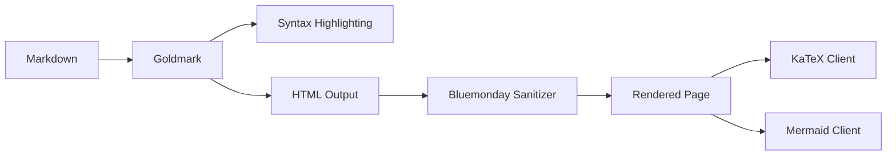

# Kitchen Sink

A note using ~~all~~ **every** advanced feature together.

## Status

| Feature       | Syntax               | Works? |
|---------------|----------------------|--------|
| Strikethrough | `~~text~~`           | ~~yes~~ Done |
| Code          | Triple backtick      | See below    |
| LaTeX         | `$...$` / `$$...$$`  | $\checkmark$ |
| Mermaid       | ` ```mermaid `       | See below    |
| Task lists    | `- [x]`              | Below        |

## Checklist

- [x] Strikethrough via GFM
- [x] Syntax-highlighted code blocks
- [x] LaTeX math rendering
- [x] Mermaid diagrams
- [ ] Rich text editor

## A Bit of Math

The area under a standard normal curve: $\frac{1}{\sqrt{2\pi}} \int_{-\infty}^{\infty} e^{-x^2/2} \, dx = 1$

The Fibonacci recurrence:

$$F_n = F_{n-1} + F_{n-2}, \quad F_0 = 0,\ F_1 = 1$$

## A Bit of Code

```go
// Render converts markdown to safe HTML.
func Render(src string) string {
    var buf bytes.Buffer
    md.Convert([]byte(src), &buf)
    return sanitizer.Sanitize(buf.String())
}
```

## A Bit of Diagram


